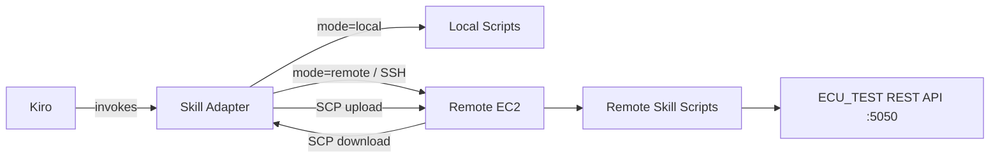
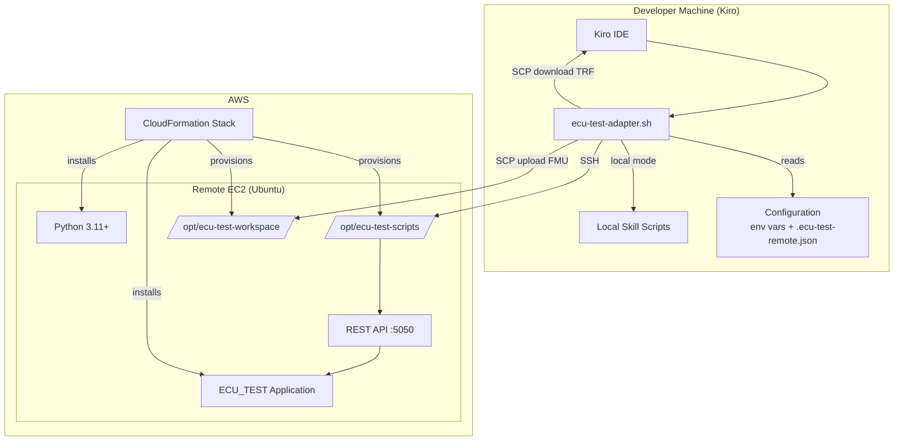
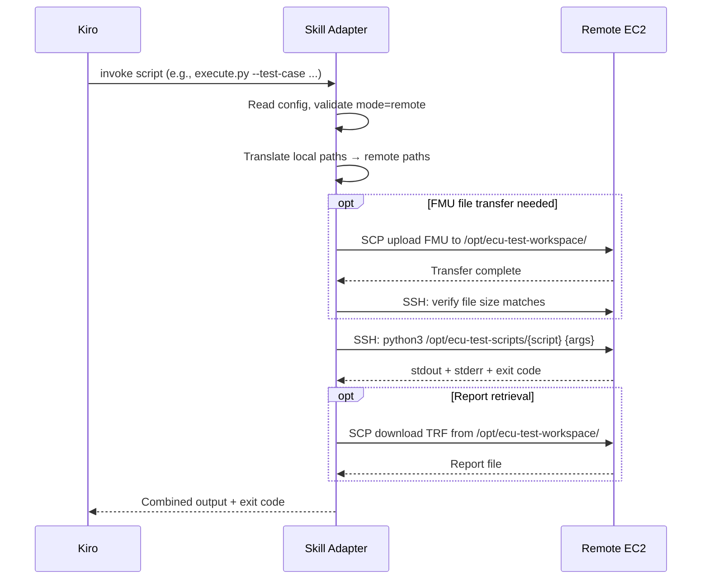

# Design Document: Remote ECU-TEST Execution

## Overview

This design describes the architecture for moving ecu.test execution from a local machine (co-located with Kiro) to a remote EC2 instance. The system introduces three main components:

1. **CloudFormation Template** — Infrastructure-as-code that provisions an Ubuntu EC2 instance with ECU_TEST installed, Python configured, and workspace directories created.
2. **Remote Skill Scripts** — Linux-adapted versions of the existing ecu-test skill scripts deployed to `/opt/ecu-test-scripts` on the remote instance.
3. **Skill Adapter** — A shell script (`ecu-test-adapter.sh`) that the ecu-test skill invokes instead of calling scripts directly. It reads configuration, determines execution mode (local vs remote), handles SSH execution, file transfer, path translation, and output capture.

The design preserves the existing local workflow unchanged — the adapter is transparent when mode is "local". In "remote" mode, it handles all SSH, SCP, and path mapping concerns so that the skill markdown guides and Kiro's orchestration logic remain unmodified.



## Architecture

### High-Level Component Diagram



### Deployment Architecture

The CloudFormation template creates a single-instance stack:

- **EC2 Instance**: t3.large (2 vCPU, 8 GiB RAM), Ubuntu 22.04 LTS, 30 GiB EBS gp3
- **Security Group**: Inbound SSH (port 22) from configurable CIDR
- **UserData/cfn-init**: Downloads and installs ECU_TEST .deb, installs Python 3.11 + requests, creates directories, deploys scripts
- **WaitCondition**: 600s timeout; signals success after all initialization completes, or failure on any error causing rollback

### Execution Flow (Remote Mode)



## Components and Interfaces

### 1. CloudFormation Template (`infra/ecu-test-ec2.yaml`)

**Inputs (Parameters):**
| Parameter | Type | Description |
|-----------|------|-------------|
| `KeyPairName` | `AWS::EC2::KeyPair::KeyName` | SSH key pair for instance access |
| `AllowedSSHCidr` | String | CIDR range for inbound SSH (e.g., `203.0.113.0/32`) |
| `InstanceType` | String | EC2 instance type (default: `t3.large`) |
| `EcuTestDebUrl` | String | URL to the ECU_TEST .deb package |

**Outputs:**
| Output | Description |
|--------|-------------|
| `InstancePublicIp` | Public IPv4 address of the EC2 instance |
| `InstancePublicDns` | Public DNS hostname of the EC2 instance |
| `InstanceId` | EC2 instance ID |

**Resources:**
- `SecurityGroup` — allows SSH from `AllowedSSHCidr`
- `EC2Instance` — Ubuntu 22.04, UserData installs ECU_TEST + Python + scripts
- `WaitCondition` + `WaitConditionHandle` — 600s initialization gate

**UserData Script Logic:**
1. `apt-get update && apt-get install -y python3.11 python3-pip`
2. `pip3 install requests`
3. Download ECU_TEST .deb from `EcuTestDebUrl`
4. `dpkg -i ecu-test.deb && apt-get install -f -y` (resolve dependencies)
5. `mkdir -p /opt/ecu-test-scripts /opt/ecu-test-workspace`
6. `chmod 755 /opt/ecu-test-scripts && chmod 777 /opt/ecu-test-workspace`
7. Deploy remote skill scripts to `/opt/ecu-test-scripts/`
8. Signal WaitCondition success (or failure on any error via `set -e` + trap)

### 2. Remote Skill Scripts (`/opt/ecu-test-scripts/`)

Each script is adapted from the existing local version with these changes:

| Script | Key Adaptations |
|--------|----------------|
| `start.py` | Uses Linux process launch (`/opt/ecu.test/bin/ecu-test` or equivalent), removes Windows-specific `creationflags`, uses `requests` for polling |
| `create_package.py` | Uses `/opt/ecu-test-workspace` as base path, Linux paths |
| `generate.py` | Same logic, Linux paths, ApiClient at `/opt/ecu.test/Templates/ApiClient` |
| `execute.py` | Same logic, Linux paths |
| `report.py` | Same logic, Linux paths |
| `configure_tcf.py` | Unchanged (already uses `urllib`, no OS-specific code) |
| `api_client_setup.py` | Simplified: only resolves `/opt/ecu.test/Templates/ApiClient` on Linux |

**Output Contract (all scripts):**
- Exit code 0 + final stdout line `SUCCESS: <summary>` on success
- Exit code non-zero + final stdout line `ERROR: <reason>` on failure
- Intermediate status lines written to stdout as plain text
- API unreachable → non-zero exit within 10 seconds

### 3. Skill Adapter (`ecu-test-adapter.sh`)

A Bash script placed at `.kiro/skills/ecu-test/scripts/ecu-test-adapter.sh`.

**Interface:**
```bash
./ecu-test-adapter.sh <script_name> [script_args...]
```

**Responsibilities:**
1. Load configuration (env vars → config file fallback)
2. Validate mode and required parameters
3. Route execution:
   - **local**: `python3 .kiro/skills/ecu-test/scripts/<script_name> <args>`
   - **remote**: `ssh <user>@<host> -i <key> python3 /opt/ecu-test-scripts/<script_name> <translated_args>`
4. Path translation: replace local workspace base path with `/opt/ecu-test-workspace`, convert `\` to `/`
5. File transfer (when needed): `scp -i <key> <local_file> <user>@<host>:/opt/ecu-test-workspace/`
6. Output capture: relay stdout/stderr, propagate exit code

**Configuration Resolution:**

Environment variables (highest priority):
| Variable | Description |
|----------|-------------|
| `ECU_TEST_MODE` | `local` or `remote` |
| `ECU_TEST_REMOTE_HOST` | Hostname/IP of Remote EC2 |
| `ECU_TEST_REMOTE_USER` | SSH username (default: `ubuntu`) |
| `ECU_TEST_REMOTE_KEY` | Path to SSH private key file |
| `ECU_TEST_LOCAL_WORKSPACE` | Local workspace base path (for path translation) |
| `ECU_TEST_REMOTE_WORKSPACE` | Remote workspace path (default: `/opt/ecu-test-workspace`) |
| `ECU_TEST_SSH_TIMEOUT` | SSH connection timeout in seconds (default: `30`) |
| `ECU_TEST_EXEC_TIMEOUT` | Script execution timeout in seconds (default: `600`) |
| `ECU_TEST_TRANSFER_TIMEOUT` | File transfer timeout in seconds (default: `300`) |

Fallback config file: `.ecu-test-remote.json` in the project root:
```json
{
  "mode": "remote",
  "remote_host": "ec2-xx-xx-xx-xx.compute-1.amazonaws.com",
  "remote_user": "ubuntu",
  "remote_key": "~/.ssh/ecu-test-key.pem",
  "local_workspace": "/Users/dev/workspace",
  "remote_workspace": "/opt/ecu-test-workspace",
  "ssh_timeout": 30,
  "exec_timeout": 600,
  "transfer_timeout": 300
}
```

### 4. File Transfer Module (within Skill Adapter)

**Upload (FMU to remote):**
```bash
scp -i "$KEY" -o ConnectTimeout="$SSH_TIMEOUT" \
    "$local_file" "${USER}@${HOST}:${REMOTE_WORKSPACE}/"
# Verify: ssh ... "stat --printf='%s' /opt/ecu-test-workspace/filename"
# Compare with local: stat -f '%z' (macOS) or stat --printf='%s' (Linux)
```

**Download (TRF report from remote):**
```bash
scp -i "$KEY" -o ConnectTimeout="$SSH_TIMEOUT" \
    "${USER}@${HOST}:${remote_report_path}" "$local_destination"
```

**Failure handling:**
- On SCP failure or size mismatch: remove partial file on remote, report error with paths
- On SSH disconnect during transfer: detect non-zero exit, attempt cleanup, report

## Data Models

### Configuration Schema (`.ecu-test-remote.json`)

```json
{
  "$schema": "http://json-schema.org/draft-07/schema#",
  "type": "object",
  "properties": {
    "mode": {
      "type": "string",
      "enum": ["local", "remote"]
    },
    "remote_host": {
      "type": "string",
      "description": "Hostname or IP of the remote EC2 instance"
    },
    "remote_user": {
      "type": "string",
      "default": "ubuntu"
    },
    "remote_key": {
      "type": "string",
      "description": "Path to SSH private key file"
    },
    "local_workspace": {
      "type": "string",
      "description": "Local workspace base path for path translation"
    },
    "remote_workspace": {
      "type": "string",
      "default": "/opt/ecu-test-workspace"
    },
    "ssh_timeout": {
      "type": "integer",
      "default": 30,
      "minimum": 1
    },
    "exec_timeout": {
      "type": "integer",
      "default": 600,
      "minimum": 1,
      "maximum": 3600
    },
    "transfer_timeout": {
      "type": "integer",
      "default": 300,
      "minimum": 1
    }
  },
  "required": ["mode"]
}
```

### Script Output Format

All remote skill scripts produce structured stdout output:

```
[optional status/progress lines]
SUCCESS: <one-line summary>
```
or
```
[optional status/progress lines]
ERROR: <one-line failure reason>
```

The Skill Adapter parses the last line beginning with `SUCCESS:` or `ERROR:` to determine outcome.

### CloudFormation Stack Outputs

```yaml
Outputs:
  InstancePublicIp:
    Value: !GetAtt EC2Instance.PublicIp
  InstancePublicDns:
    Value: !GetAtt EC2Instance.PublicDnsName
  InstanceId:
    Value: !Ref EC2Instance
```

### Path Translation Model

| Local Path Pattern | Remote Path |
|-------------------|-------------|
| `{local_workspace}/Packages/test.pkg` | `/opt/ecu-test-workspace/Packages/test.pkg` |
| `{local_workspace}/Models/model.fmu` | `/opt/ecu-test-workspace/Models/model.fmu` |
| `C:\workspace\Reports\test.trf` | `/opt/ecu-test-workspace/Reports/test.trf` |

Translation rules:
1. Replace `local_workspace` prefix with `remote_workspace`
2. Convert all `\` to `/`
3. Preserve relative path structure after the workspace root

## Correctness Properties

*A property is a characteristic or behavior that should hold true across all valid executions of a system — essentially, a formal statement about what the system should do. Properties serve as the bridge between human-readable specifications and machine-verifiable correctness guarantees.*

### Property 1: Path translation round-trip preserves relative structure

*For any* local file path that starts with the configured local workspace prefix, translating it to a remote path should: (1) replace the local workspace prefix with the remote workspace prefix (`/opt/ecu-test-workspace`), (2) convert all backslash separators to forward slashes, and (3) preserve the relative path segments after the workspace root unchanged.

**Validates: Requirements 4.8, 7.5**

### Property 2: Mode validation accepts only valid modes

*For any* string value provided as the execution mode, the Skill Adapter should accept it if and only if it equals "local" or "remote". All other strings (including empty string, whitespace, mixed case like "Local" or "REMOTE", and arbitrary text) should be rejected with an error message that states the invalid value and lists both accepted values.

**Validates: Requirements 5.1, 5.6**

### Property 3: Configuration resolution precedence

*For any* configuration parameter that has a value set in both an environment variable and the configuration file, the Skill Adapter should use the environment variable value. *For any* configuration parameter that has a value set only in the configuration file (with the environment variable unset or empty), the Skill Adapter should use the configuration file value.

**Validates: Requirements 5.4**

### Property 4: Missing parameter detection is complete

*For any* non-empty subset of the required remote connection parameters (hostname, username, key path) that is absent from both environment variables and the configuration file, the Skill Adapter's error message should list exactly those missing parameter names — no more, no fewer.

**Validates: Requirements 5.7**

### Property 5: Argument forwarding preserves order and content

*For any* list of command-line arguments (including arguments containing spaces, quotes, special shell characters, and empty strings), the SSH command constructed by the Skill Adapter should preserve all arguments in their original order with their original content when received by the remote script.

**Validates: Requirements 4.3**

## Error Handling

### Connection Errors

| Scenario | Behavior |
|----------|----------|
| SSH connection timeout (>30s) | Report error with target hostname, do not retry |
| SSH connection refused | Report error with hostname and port, suggest checking security group |
| SSH authentication failure | Report error indicating key path and username |
| SSH connection lost mid-transfer | Remove partial file on remote (best-effort), report failure with file paths |

### Script Execution Errors

| Scenario | Behavior |
|----------|----------|
| Script returns non-zero exit | Capture stderr, report script name + stderr content |
| Script exceeds execution timeout | Kill SSH session, report timeout with script name and elapsed time |
| Script not found on remote | Report missing script path |
| Python not available on remote | Report environment error |

### File Transfer Errors

| Scenario | Behavior |
|----------|----------|
| SCP upload fails | Report source path, destination path, and SCP error message |
| SCP upload timeout | Report timeout with file path and configured timeout value |
| File size mismatch after transfer | Remove remote file, report mismatch with both sizes |
| Local file not found for upload | Report missing local file path before attempting transfer |
| Remote file not found for download | Report missing remote file path |

### Configuration Errors

| Scenario | Behavior |
|----------|----------|
| Invalid mode value | Report invalid value and list accepted values ("local", "remote") |
| Missing required remote params | List each missing parameter by name |
| Config file not found (no env vars) | Report that neither env vars nor config file provide required values |
| Config file malformed JSON | Report parse error with file path |
| SSH key file not found | Report missing key file path |

### ECU_TEST Lifecycle Errors

| Scenario | Behavior |
|----------|----------|
| ECU_TEST not responding after start | start.py returns non-zero after 60s polling |
| ECU_TEST REST API returns non-200 | Report HTTP status code and response body |
| ECU_TEST busy (409) during execution | Retry up to 120s (existing behavior in execute.py) |

## Testing Strategy

### Testing Approach

This feature spans infrastructure (CloudFormation), shell scripting (Bash adapter), and Python script adaptations. The testing strategy uses a layered approach:

1. **Property-based tests** — For pure logic in the Skill Adapter (path translation, config resolution, mode validation, argument construction)
2. **Unit tests** — For specific examples, edge cases, and error message formatting
3. **Integration tests** — For SSH connectivity, file transfer, and end-to-end workflow on a real EC2 instance
4. **Smoke tests** — For CloudFormation deployment verification

### Property-Based Testing

**Library**: [Hypothesis](https://hypothesis.readthedocs.io/) (Python) for testing the adapter's pure logic functions extracted into a testable Python module.

**Rationale**: The Skill Adapter is a Bash script, but its core logic (path translation, config resolution, argument escaping) will be extracted into a Python helper module (`adapter_logic.py`) that can be tested with Hypothesis. This keeps the Bash script thin (orchestration only) while making the logic testable.

**Configuration**: Minimum 100 iterations per property test.

**Tag format**: Each test tagged with `# Feature: remote-ecu-test-execution, Property {N}: {title}`

| Property | Test Description | Generator Strategy |
|----------|-----------------|-------------------|
| 1 | Path translation | Generate paths with mixed separators, spaces, unicode, nested dirs, trailing slashes |
| 2 | Mode validation | Generate arbitrary strings including near-misses ("Local", "REMOTE", " remote") |
| 3 | Config precedence | Generate config dicts and env var dicts with overlapping/disjoint keys |
| 4 | Missing params | Generate all subsets of {hostname, username, key_path} as missing |
| 5 | Argument forwarding | Generate lists of strings with shell metacharacters, quotes, spaces, newlines |

### Unit Tests

| Area | Tests |
|------|-------|
| Path translation edge cases | Empty path, path without workspace prefix, path that IS the workspace prefix |
| Config file parsing | Valid JSON, empty file, missing file, malformed JSON |
| Output parsing | Parse SUCCESS/ERROR lines from script output |
| Error message formatting | Verify error messages contain required fields |
| Timeout validation | Boundary values (0, 1, 3600, 3601) |

### Integration Tests

| Area | Tests | Prerequisites |
|------|-------|---------------|
| CloudFormation deployment | Deploy stack, verify outputs | AWS credentials, key pair |
| SSH connectivity | Connect to instance, run `echo hello` | Deployed stack |
| File transfer | Upload file, verify size, download file | Deployed stack |
| Remote script execution | Run each script with valid inputs | Deployed stack + ECU_TEST running |
| End-to-end workflow | Full create→generate→execute→report | Deployed stack + ECU_TEST + FMU file |
| ECU_TEST lifecycle | Start ECU_TEST, verify API responds | Deployed stack |

### Smoke Tests

| Test | Validates |
|------|-----------|
| Stack deploys successfully | Req 1.1–1.9 |
| Instance has Python 3.11+ | Req 1.8 |
| Instance has ECU_TEST installed | Req 1.5 |
| Scripts present at /opt/ecu-test-scripts/ | Req 2.1 |
| Workspace directory exists with correct permissions | Req 1.7 |

### Test File Structure

```
tests/
├── unit/
│   ├── test_adapter_logic.py          # Property + unit tests for pure logic
│   └── test_config_parsing.py         # Config file parsing tests
├── integration/
│   ├── test_ssh_connectivity.py       # SSH connection tests
│   ├── test_file_transfer.py          # SCP upload/download tests
│   ├── test_remote_scripts.py         # Remote script execution tests
│   └── test_end_to_end.py            # Full workflow tests
└── smoke/
    └── test_stack_deployment.py       # Post-deployment verification
```

