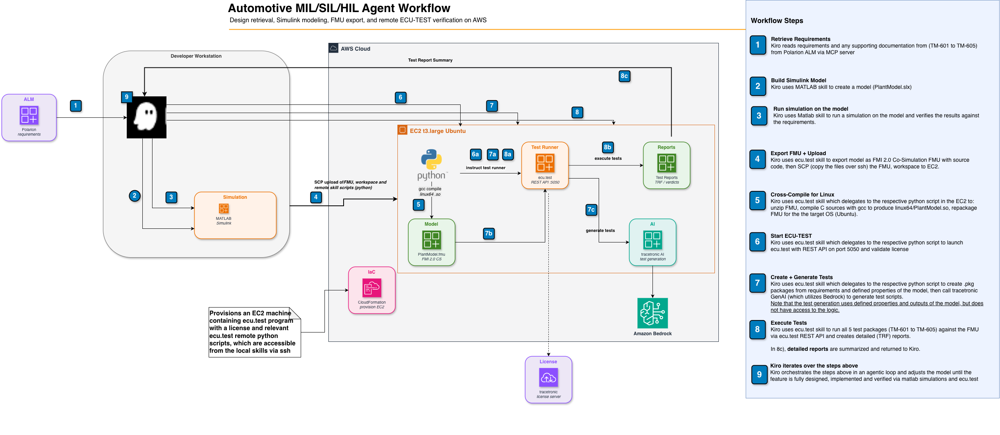

# Automotive SDLC Agent for MIL/SIL/HIL

An AI-assisted automotive software development lifecycle (SDLC) workflow integrating Polarion ALM, MATLAB/Simulink, and Kiro IDE for Model-in-the-Loop (MIL), Software-in-the-Loop (SIL), and Hardware-in-the-Loop (HIL) development.

## Overview

This project demonstrates an end-to-end automotive development workflow where:

1. **Requirements** are managed in Polarion ALM (system requirements, software requirements, test cases)
2. **Simulink models** are created from requirements using the Simulink Agentic Toolkit
3. **FMU export** packages models as Functional Mock-up Units for co-simulation and deployment
4. **Traceability** links requirements → models → tests across the toolchain

## Architecture



The diagram shows the end-to-end flow orchestrated by Kiro on the developer workstation:

1. **Requirements retrieval** — Kiro pulls system requirements and test cases from Polarion ALM (or reads local sample requirements)
2. **Model creation** — MATLAB/Simulink builds a model implementing the required behavior
3. **FMU export** — The model is exported as a source-code FMU (FMI 2.0 Co-Simulation)
4. **Infrastructure provisioning** — An EC2 instance running ecu.test is provisioned via CloudFormation
5. **Workspace sync** — Configurations, parameters, and the source-only FMU are uploaded to the remote instance
6. **FMU compilation** — The C sources are compiled for linux64 on the EC2 instance using gcc
7. **Test package creation** — Requirements are decomposed into precondition/action/postcondition steps and written as ecu.test packages
8. **AI test generation** — ecu.test's AI agent generates executable test scripts from the packages
9. **Test execution & reporting** — Tests run against the live FMU simulation; results are analyzed and reported back to the developer

## Skills & MCP Architecture

This project uses a two-layer architecture for AI assistance:

- **MCP Servers** (execution layer) — provide raw tool capability (`model_edit`, `model_test`, `evaluate_matlab_code`, Polarion work item operations)
- **Skills** (knowledge layer) — sit on top of MCP tools and provide workflow guidance, guardrails, and domain-specific rules for correct tool usage

Seven skills are sourced from the [Simulink Agentic Toolkit](https://github.com/matlab/simulink-agentic-toolkit) (MathWorks upstream). One skill (`ecu-test`) is project-specific. Both the MCP server and the corresponding skills must be installed for the full workflow to function.

For detailed classification, source attribution, and steering file documentation, see [docs/skill-architecture.md](docs/skill-architecture.md).

## Prerequisites

This project supports two operational modes:

| Mode | Local requirements | AWS/SSH needed? | Use case |
|------|-------------------|-----------------|----------|
| **Local-only** | MATLAB + Simulink + ecu.test installed locally | No | Full MIL workflow on a single machine |
| **Remote** | MATLAB + Simulink locally | Yes | ecu.test on EC2; FMU compiled remotely on Linux |

In **local-only mode**, you run ecu.test directly on your machine. The `.ecu-test-remote.json` file is not needed — the adapter defaults to local script execution. No AWS credentials or SSH keys are required.

In **remote mode**, MATLAB stays local for model creation and FMU export (source-only), while ecu.test runs on a provisioned EC2 instance. You need AWS CLI, an SSH key, and a running EC2 instance (see `infra/ecu-test-ec2.yaml`). The `.ecu-test-remote.json` configures the connection.

The MCP config (`.kiro/settings/mcp.json`) works identically in both modes — remote settings live exclusively in `.ecu-test-remote.json`.

---

Run the setup verification script to quickly check all prerequisites:

```bash
./scripts/verify-setup.sh
```

The script checks MATLAB, Simulink Agentic Toolkit, Python 3.11+, Polarion MCP venv, `.ecu-test-remote.json` (optional for local-only), and AWS CLI (optional for local-only), reporting PASS/FAIL/WARN for each.

### macOS C Compiler (Xcode)

MATLAB requires a C compiler for code generation and FMU export. On macOS, this means installing **Xcode**:

1. Install **Xcode** from the Mac App Store (free, ~12 GB)
2. Open Xcode once and **accept the license agreement** when prompted
3. Verify from terminal:
   ```bash
   sudo xcodebuild -license accept
   xcode-select -p   # Should show /Applications/Xcode.app/Contents/Developer
   ```

> **Note:** The Command Line Tools alone (`xcode-select --install`) provide `clang`, but MATLAB's `mex -setup` requires the full Xcode.app license to be accepted. Without this, FMU export will fail with "Supported compiler not detected."

### MATLAB / Simulink

- **MATLAB R2025b** (or later)
- **Simulink** (included with MATLAB)
- **Simulink Coder** — code generation
- **Simulink Compiler** — FMU export support
- **Embedded Coder** — production code generation
- **FMU Builder for Simulink** — support package (install via Add-On Explorer)

#### Installing FMU Builder for Simulink

1. Open MATLAB
2. Go to **Home > Add-Ons > Get Add-Ons**
3. Search for **"FMU Builder for Simulink"**
4. Click **Install**

Alternatively, from the MATLAB command window:

```matlab
matlab.internal.addons.launchers.showExplorer('tripwire','identifier','FMUBUILDER');
```

### Simulink Agentic Toolkit (MCP Server)

The MATLAB MCP server enables AI-assisted Simulink model creation and manipulation. It is installed from the [simulink-agentic-toolkit](https://github.com/matlab/simulink-agentic-toolkit) repository.

**Installation:**

```bash
# Clone into this project (already done — lives at simulink-agentic-toolkit/)
git clone https://github.com/matlab/simulink-agentic-toolkit.git
```

The `simulink-agentic-toolkit/` folder **must remain in the project** — the MCP server references `tools/tools.json` at runtime for Simulink model editing, reading, testing, and parameter resolution tools.

**MCP Core Server binary:** Installed separately at a location like `/Users/<you>/dev/matlab/matlab-mcp-core-server`. See the [toolkit README](simulink-agentic-toolkit/README.md) for download instructions.

**Configuration** (in `.kiro/settings/mcp.json`):

```json
{
  "mcpServers": {
    "matlab": {
      "command": "/path/to/matlab-mcp-core-server",
      "args": [
        "--matlab-root=/Applications/MATLAB_R2025b.app",
        "--extension-file=/path/to/simulink-agentic-toolkit/tools/tools.json"
      ],
      "autoApprove": [
        "evaluate_matlab_code",
        "run_matlab_file",
        "run_matlab_test_file",
        "check_matlab_code",
        "detect_matlab_toolboxes",
        "model_edit",
        "model_overview"
      ]
    }
  }
}
```

### Polarion ALM Integration (MCP Server)

Connects to Polarion for requirements management and traceability.

**Setup:**

1. Navigate to `polarion-integration/polarion-mcp/`
2. Create a Python virtual environment: `python -m venv .venv`
3. Install dependencies: `pip install -e .`
4. Configure environment variables (see `.env.example`):
   - `POLARION_URL` — Polarion server URL
   - `POLARION_USER` — Username
   - `POLARION_TOKEN` — Personal access token
   - `POLARION_CONFIG_PATH` — Path to project config YAML

## Session Workflow

This section documents the typical end-to-end workflow. The project is **requirement-agnostic** — it works with any set of requirements, whether retrieved from Polarion or provided as local markdown files.

### 1. Validate Toolchain Connectivity

```
- Verify MATLAB MCP server connection via detect_matlab_toolboxes
- Confirm Simulink, Simulink Coder, Simulink Compiler, Embedded Coder available
- Verify Polarion MCP server connection (if using Polarion for requirements)
```

### 2. Retrieve or Load Requirements

**Option A — From Polarion ALM:**
```
- Connect via Polarion MCP server
- Query work items (system requirements, test cases)
- Use requirement descriptions to drive model creation
```

**Option B — From local markdown files (no Polarion access needed):**
```
- Read requirements from sample-requirements/
- Sample requirements (TM-601..TM-605) are provided for a thermal monitoring use case
- Replace or extend these with your own requirements
```

### 3. Create Simulink Model from Requirements

Using the MATLAB MCP tools, create a Simulink model that implements the behavior described in the requirements. The model should:
- Use fixed-step discrete solver (required for FMU export)
- Expose output signals as Outport blocks matching the signal names referenced in test cases
- Be saved to `matlab-models/`

### 4. Export as FMU and Deploy to Remote

```matlab
exportToFMU('<ModelName>', ...
    'FMIVersion', '2.0', ...
    'FMUType', 'CS', ...
    'SaveSourceCodeToFMU', 'on', ...
    'SaveDirectory', '<workspace>/ecu.test-integration/ecu.test_agent_fmu_demo/fmu');
```

Then sync and compile on the remote:
```bash
./scripts/ecu-test-adapter.sh --sync
ssh <remote> "cd /opt/ecu-test-workspace/fmu && python3 compile_fmu.py <ModelName>.fmu"
```

### 5. Create Packages, Generate Scripts, Execute Tests

Using the ecu.test skill:
```bash
# Create test packages from requirement steps
./scripts/ecu-test-adapter.sh create_package.py --pre-step "..." --action-step "..." --post-step "..." --output "/opt/ecu-test-workspace/Packages/<test>.pkg"

# Generate AI test scripts
./scripts/ecu-test-adapter.sh generate.py --tcf "fmu.tcf" --package "/opt/ecu-test-workspace/Packages/<test>.pkg"

# Execute
./scripts/ecu-test-adapter.sh execute.py --test-case "/opt/ecu-test-workspace/Packages/<test>.pkg" --tbc "fmu.tbc" --tcf "fmu.tcf"

# Analyze report
./scripts/ecu-test-adapter.sh report.py --report-path "/opt/ecu-test-workspace/TestReports/<test>_<date>/<test>.trf"
```

## Project Structure

```
├── .kiro/
│   ├── settings/
│   │   └── mcp.json                 # MCP server configuration
│   ├── skills/
│   │   ├── building-simulink-models/    # MathWorks upstream skill
│   │   ├── simulating-simulink-models/  # MathWorks upstream skill
│   │   ├── testing-simulink-models/     # MathWorks upstream skill
│   │   ├── generate-requirement-drafts/ # MathWorks upstream skill
│   │   ├── specifying-mbd-algorithms/   # MathWorks upstream skill
│   │   ├── specifying-plant-models/     # MathWorks upstream skill
│   │   ├── filing-bug-reports/          # MathWorks upstream skill
│   │   └── ecu-test/                # Project-specific ECU-TEST skill
│   │       ├── SKILL.md             # Skill definition and remote setup guide
│   │       ├── scripts/
│   │       │   ├── ecu-test-adapter.sh   # Adapter (local/remote routing)
│   │       │   ├── resolve_config.py     # Config resolution helper
│   │       │   ├── adapter_logic.py      # Pure logic (path translation, validation)
│   │       │   ├── remote/               # Linux-adapted scripts for EC2
│   │       │   └── *.py                  # Local scripts
│   │       └── *.md                 # Capability guides
│   ├── specs/
│   │   ├── remote-ecu-test-execution/   # Spec: remote execution feature
│   │   └── repository-optimization/     # Spec: repo cleanup
│   └── steering/
│       ├── matlab-simulink-setup.md         # MATLAB env + FMU build policy
│       ├── ecu-test-project-config.md       # Project-specific model knowledge
│       └── session-setup-checklist.md       # Quick pre-flight verification
├── docs/
│   ├── skill-architecture.md        # Skills & MCP layering documentation
│   ├── skill-versions.md            # Upstream skill version tracking
│   └── examples/                    # Demo artifacts and sample prompts
├── ecu.test-integration/
│   ├── ecu.test_agent_fmu_demo/     # ECU-TEST workspace
│   │   ├── .workspace/             # Workspace config (agent.xml, etc.)
│   │   ├── Configurations/         # TBC and TCF files
│   │   ├── Parameters/FMU/         # XAM signal mapping
│   │   ├── fmu/                    # FMU model files
│   │   └── Packages/               # Generated test packages
│   └── reports/                    # Test execution reports (gitignored)
├── matlab-models/                  # Runtime — populated during demo sessions
├── sample-requirements/            # Sample test case requirements (TM-601..TM-605)
├── scripts/
│   └── build_fmu_remote.sh         # Standalone FMU remote compilation
├── infra/
│   └── ecu-test-ec2.yaml           # CloudFormation template for remote EC2
├── polarion-integration/
│   └── polarion-mcp/               # Polarion MCP server source
├── simulink-agentic-toolkit/       # Cloned from github.com/matlab/simulink-agentic-toolkit
├── tests/
│   └── unit/
│       └── test_adapter_logic.py   # Property-based + unit tests
├── .env.example                    # Environment variable template
├── .ecu-test-remote.json.example   # Remote config template
└── README.md                       # This file
```

## Steering Files

Steering files provide project-specific context to Kiro sessions. All use `inclusion: manual` — activate them with `#filename` in chat when relevant.

| Steering File | Activate when… |
|---|---|
| `matlab-simulink-setup` | Starting a session involving model creation, FMU export, or MATLAB environment setup |
| `ecu-test-project-config` | Running tests against the Temperature Monitoring System model (signal names, thresholds, Polarion traceability) |
| `session-setup-checklist` | Troubleshooting connectivity or verifying prerequisites before a session |

Steering files live in `.kiro/steering/`. They supplement skills with project-specific values — they do not contain operational procedures (those live in the skills).

## Convenience Scripts

| Script | Purpose |
|---|---|
| `scripts/build_fmu_remote.sh` | Standalone remote FMU compilation via SSH. For the full workflow, use `ecu-test-adapter.sh --sync` then compile. |
| `scripts/verify-setup.sh` | Check all prerequisites (MATLAB, toolkit, Python, Polarion venv, AWS CLI). Reports PASS/FAIL/WARN. |

## Remote ECU-TEST Execution

The project supports running ecu.test on a remote EC2 instance via SSH. This decouples the test execution environment from the development machine.

### Architecture

```
Developer Machine (Kiro)          AWS EC2 (Ubuntu 22.04, t3.large)
┌─────────────────────┐           ┌──────────────────────────────┐
│ ecu-test-adapter.sh │──── SSH ──│ remote scripts (configurable)│
│ .ecu-test-remote.json│──── SCP ──│ workspace (configurable)     │
└─────────────────────┘           │ ecu.test + REST API :5050    │
                                  └──────────────────────────────┘
```

### Configuration

All remote execution settings are centralized in `.ecu-test-remote.json` (see `.ecu-test-remote.json.example`):

```json
{
  "mode": "remote",
  "hostname": "ec2-xx-xx-xx-xx.compute-1.amazonaws.com",
  "username": "ubuntu",
  "key_path": "~/.ssh/my-key.pem",
  "local_workspace": "/path/to/ecu.test-workspace",
  "remote_workspace": "/opt/ecu-test-workspace",
  "remote_scripts_dir": "/opt/ecu-test-scripts",
  "exe_path": "/usr/bin/ecu.test",
  "license": "YOUR_LICENSE_STRING",
  "tbc_name": "MyBench.tbc",
  "tcf_name": "MyConfig.tcf"
}
```

### Key Operational Details

1. **ECU-TEST version**: Must match the license. Configure `exe_path` in `.ecu-test-remote.json` to point to the installed binary.

2. **License**: Set the `license` field in `.ecu-test-remote.json`. The adapter passes it as `TRACET_LICENSE` when starting ECU-TEST.

3. **FMU compilation on remote**: FMUs are exported from MATLAB/Simulink as source-only (using `exportToFMU` with `'BuildConfiguration','source-code'`). After syncing to the remote, compile with `python3 compile_fmu.py` which uses `gcc` to build the linux64 shared library.

4. **Workspace sync**: Use `./scripts/ecu-test-adapter.sh --sync` to upload the workspace (`.workspace/`, `Configurations/`, `Parameters/`, `fmu/`) to the remote.

5. **ECU-TEST start**: Use `./scripts/ecu-test-adapter.sh start.py` — the adapter passes `--workspaceDir` and license from config automatically.

6. **Path conventions**:
   - TCF/TBC: use filenames only (configured as `tbc_name`/`tcf_name`) — ECU-TEST resolves from workspace
   - Test case packages: use absolute paths on the remote
   - Package output: use absolute paths on the remote

7. **AI Agent**: The `.workspace/agent.xml` must contain a reachable agent URL and your ECU-TEST agent API token (`API-TOKEN`) for `GenerateViaAi()` to work. The file is gitignored because it holds the token. Create it from the template before the first `--sync`:
   ```bash
   cp ecu.test-integration/ecu.test_agent_fmu_demo/.workspace/agent.xml.example \
      ecu.test-integration/ecu.test_agent_fmu_demo/.workspace/agent.xml
   # then replace YOUR_ECU_TEST_AGENT_API_TOKEN with your token
   ```

See [SKILL.md](.kiro/skills/ecu-test/SKILL.md) for full setup instructions and the [steering file](.kiro/steering/ecu-test-project-config.md) for project-specific configuration details.

## License

See [LICENSE](LICENSE) for details.
